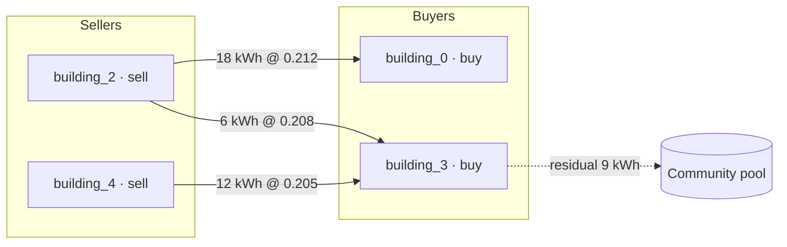

# Phase 2b — P2P market UX spec (trade flow + settlement ledger)

Owner: Product Design Lead · Date: 2026-11-03
Status: **spec only, no code.** P2P runs are not yet scheduled (see the readiness note below).
Grounding: `src/coordination/p2p.py` (`P2POrder`, `P2PTrade`, `P2PMatchingEngine`),
`src/simulation/settlement.py` (`SettlementResult`), `docs/phase2_market_settlement_design.md`,
`docs/phase2-design-review-lmp-p2p-agent.md` §4.2.

> **Readiness gate.** The engine, schemas and invariant tests exist, but no `p2p` runs are executed
> and there is no P2P WebSocket endpoint. Build these surfaces **behind a feature flag** only after
> PM confirms the `p2p` regime is scheduled and the endpoint exists. Until then this is a design
> reference, not a shipping surface.

## Subject, audience, job

Community members and the community operator want to see **how peer trades formed and what each
member paid or was paid**. The job is: inspect a batch (who matched with whom, at what price),
audit the settlement ledger, and compare a member's P2P outcome against the pool baseline. This is an
audit surface — it must be precise and honest, not celebratory.

## Market semantics the UI must reflect

- **Batch double auction per interval**; the contract length is **1 settlement interval (1 h)** (locked).
- **Uniform clearing price within a batch** (`clearing_price`).
- **Price–time priority**: higher buy price first, lower sell price first, earlier timestamp breaks ties.
- **Residual to pool**: unmatched volume clears in the community pool (P2P first → pool residual).

## Surfaces

### A. Orderbook (per batch)

Two columns — **Buy (left)** and **Sell (right)** — table-dense, price/time ordered.

- Columns: member · quantity (kWh) · price ($/kWh) · filled % · status.
- **Colour:** buy = `--color-load` (rose, import side), sell = `--color-energy` (emerald, export side).
  (Consistent with import/export physics; the earlier proposal that inverted these is wrong.)
- **Order states** (never colour-only): Pending (hollow dot) · Partial (stripe + `n%`) ·
  Filled (solid + check) · Cancelled (strikethrough) · Rejected (✕).
- A **clearing-price rule** line across both columns at `clearing_price` (neutral ink), with the
  batch interval label and the residual volume routed to the pool.

### B. Trade-flow visualization

Primary graph: a **bipartite flow** of matched trades within the selected batch — seller nodes left,
buyer nodes right, edges weighted by kWh, edge label = settled price. Optional time view: a stacked
per-interval bar of matched volume vs pool residual.

- Edge colour = neutral (price is a measured quantity, not good/bad); thickness = kWh; label = price.
- **Match connector** is a neutral ink line (dashed = partial), **not** `--color-comfort`.
- Carbon: if shown, badge from generation mix × emission factor (`--color-carbon`), **never derived
  from price**.

### C. Settlement ledger (per run)

Auditable table, one row per member per interval (grouped by member by default):

| Column | Source |
|---|---|
| Member | `SettlementResult` per-member |
| Bought / Sold (kWh) | `total_bought_kwh` / `total_sold_kwh` |
| P2P cost / revenue ($) | trade `price_per_kwh` × quantity |
| Pool residual (kWh) | unmatched volume → pool |
| Baseline grid bill ($) | pre-trade tariff bill |
| Δ vs baseline ($) | post-trade − baseline |

- **Δ is shown as a signed value with the reference stated** ("vs no-sharing tariff baseline"), never
  labelled "savings"; no green/red valence on price deltas (see the LMP review's B2).
- Reconciliation footer: `Σ buyer payments − Σ seller revenue = 0` (money conservation) and
  `Σ traded energy` — surfaces the invariant the engine already tests.

### D. Member statement (drill-in)

Per-member timeline for the run: buy/sell bars per interval, cumulative position, and the pool
fallback share. Exportable as CSV/Markdown (matches the paper-reproducibility convention).

## Interaction

- Time scrub selects the batch; the orderbook and trade flow follow the current interval.
- Member focus (from the ledger) highlights that member's edges and rows across all surfaces.
- Locality filter (bus-hops) and duration are **fixed to 1 interval** for now — no multi-option
  duration dropdown (contract length is locked).
- Empty/loading/error states via `components/ui/AsyncStates.tsx` (currently unwired — wire it here).

## Accessibility

- Every graph (orderbook flow, trade flow) has a **table equivalent**; the viz is an enhancement.
- No colour-only encoding: state = glyph + text; buy/sell = label, not just hue.
- Keyboard: orderbook/ledger are real tables with roving focus; batch selection via arrow keys.
- Announce batch changes with `aria-live="polite"`.

## Open questions

1. Should the trade flow be per-batch (recommended) or aggregate the run?
2. Ledger default grouping: by member, or by interval?
3. Anonymise member IDs in shared/screenshot views (orderbooks reveal flexibility)?
4. Does the pool residual belong in this view or the community-pool view?
